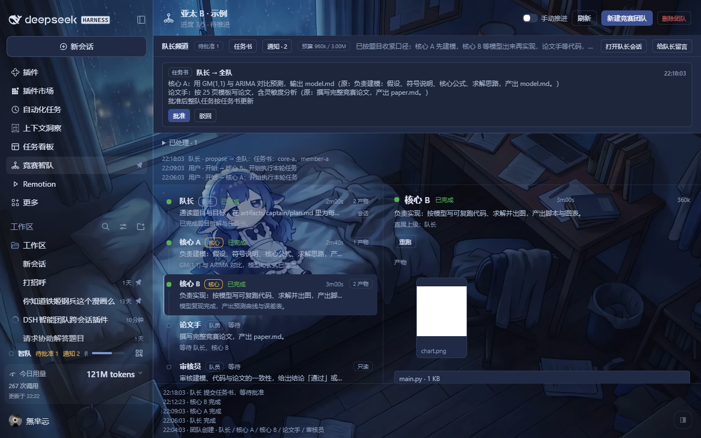
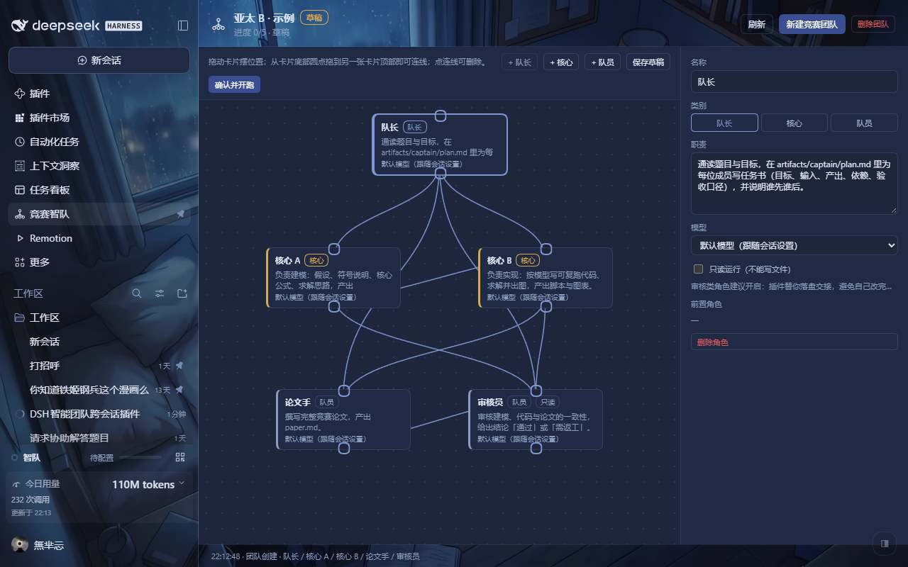

# dsh-competition-team

English | [中文](README.md)

[](https://github.com/zpb332/dsh-competition-team/actions/workflows/test.yml)
[](https://github.com/zpb332/dsh-competition-team/releases/latest)

> A competition team for DeepSeek Harness: a captain plans and dispatches, core members and workers run in independent sessions, and the panel lets you approve proposals, watch progress and cap the token budget.

A DSH plugin, not a standalone app. Once installed, a **Competition Team** entry appears in the left sidebar.





## Features

- **Independent sessions** — the captain, core roles and members are ordinary DSH sessions; they collaborate through `handoffs/` files instead of a shared context.
- **Canvas workflow** — drag roles, connect dependencies, pick a model per role, then confirm.
- **Captain channel** — talk to the captain directly. It analyzes and proposes `dispatch / message / revise`; you approve, reject or edit before anything runs. Proposals are re-checked against the current state before execution.
- **Task book** — the captain writes a per-member task book in `artifacts/captain/plan.md`; the plugin turns it into one batch proposal. Approving updates every member's task at once.
- **Trustworthy acceptance** — structured hand-offs, artifact existence checks, deterministic quality gates (empty files, broken images, thin papers), and a read-only reviewer by default.
- **Budget** — token usage per member, team cap (3M by default), warn at 80%, pause at 100%.
- **Self-healing** — a stalled turn is cancelled and retried once; interrupted turns resume once after a host reload; confirmed-but-idle teams are picked up on startup.
- **Audit & inbox** — every proposal, approval, dispatch, budget event, stall and quality warning is recorded; missed alerts stay in a persistent inbox.
- **Retries** — transient provider errors (429/5xx/timeouts) are retried twice with backoff; permanent errors fail fast with a code.

## Requirements

- DeepSeek Harness `>= 0.2.1` (verified against `0.2.2-rc.3` desktop runtime)
- Node.js `>= 20` (tests only)

## Install

The plugin is not on npm. Install it from the GitHub source.

### Regular users

**DSH Desktop**: open the install entry under Settings → Plugins and paste:

```text
github:zpb332/dsh-competition-team
```

Menu names differ slightly between DSH versions; if your build has no source-install field, use the CLI below.

**dsh web / custom profile**:

```bash
dsh plugin --profile web add github:zpb332/dsh-competition-team
```

Replace `web` with your profile name. The Desktop profile is managed by the app; don't edit it by hand.

Reload the plugin (or disable/enable it) and the **Competition Team** icon appears in the sidebar.

> `github:` installs the default branch. Pin a commit for a reproducible version: `github:zpb332/dsh-competition-team#<40-char commit>`; market entries pin commits too.

### Local development (link)

Clone the repo and link the local directory into your profile:

1. Clone the repo:
   ```bash
   git clone https://github.com/ZPB332/dsh-competition-team.git
   ```
2. Add it to your DSH profile `package.json` (quote Windows paths):
   ```json
   {
     "dependencies": {
       "dsh-competition-team": "link:/absolute/path/to/dsh-competition-team"
     },
     "dsh": {
       "profile": {
         "bundles": ["dsh-competition-team"]
       }
     }
   }
   ```
3. Reload the plugin from DSH's plugin settings (or disable/enable it in the plugin manager).
4. The **Competition Team** icon appears in the sidebar.

> Profile fields differ slightly between DSH versions; follow your version's plugin installation docs.

## Quick start

1. Click **Competition Team** → **New team**, fill in the problem and goal.
2. Confirm the default roster (captain / core A / core B / writer / reviewer); edit tasks, dependencies and models on the canvas.
3. Click **Confirm and run**. The captain reads the brief, writes a task book and submits a proposal.
4. Approve the task book in the captain channel; members start in dependency order.
5. Message the captain anytime; its changes become proposals until you approve them.
6. Watch recent activity, artifacts, hand-offs, token usage and blockers per member.

## Data layout

Team data lives in the current workspace:

```
<workspace>/.dsh-competition/<teamId>/
  brief.md
  team.json
  handoffs/<role>.md
  artifacts/<role>/
```

The plugin index is `$DSH_HOME/data/competition-team/index.json`. Do not commit these directories.

## Configuration

| Variable | Default | Purpose |
| --- | --- | --- |
| `COMPETITION_STALL_MS` | `480000` (8 min) | No event for this long marks a member stalled |
| `COMPETITION_RETRY_MS` | `5000` | Base backoff for transient retries (second retry is 3×) |

## Development

```bash
node --test
```

Tests use a mock host and temporary directories; DSH does not need to be running. Coverage includes hand-offs, DAG validation, guards, read-only review, proposals and conflicts, budget, stall/resume, task books, quality gates, error retries and HTTP routes.

Structure:

- `index.js` — host half: team state machine, session scheduling, HTTP routes, tool definition.
- `lib/` — pure modules (hand-off parsing, DAG validation, error classification, quality checks).
- `client.js` — web half: sidebar entry, panel, canvas, proposal/budget UI.
- `test/`, `test-support/` — `node:test` cases, mock host and HTTP request stubs.
- `docs/DETAIL.md` — implementation details and boundaries.

## Known limitations

- Browser notifications only fire while the panel is open; DSH has no general OS notification API. Missed alerts stay in the persistent inbox.
- Quality checks are deterministic (size, magic bytes, section keywords); they do not run code or call a judge model.
- Budget is team-level only; no per-member cap.
- Host and client are still large single files, and client rendering has no automated tests.
- Depends on DSH internal Session/SessionController APIs; minor DSH upgrades may require adaptation.

## Security

- HTTP routes are same-origin only and require the `x-competition-team: 1` header.
- Artifact reads are confined to the team directory; path traversal is rejected.
- Member sandboxes follow DSH permission presets (the reviewer runs read-only by default).

## License

MIT — see [LICENSE](LICENSE).