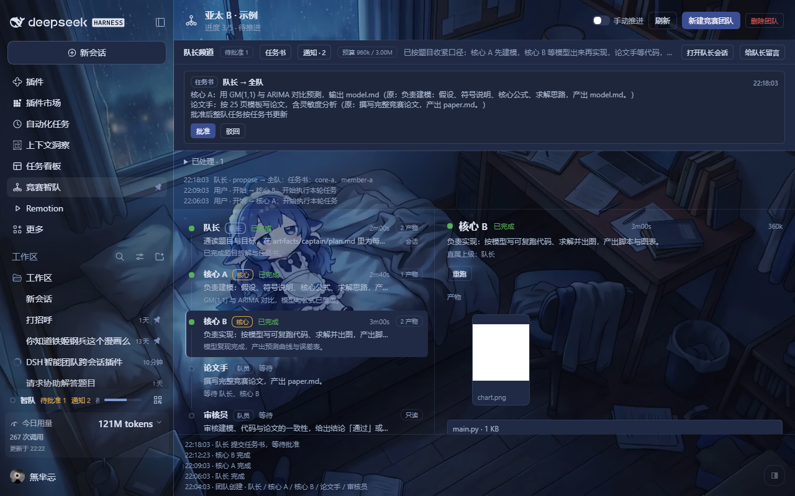
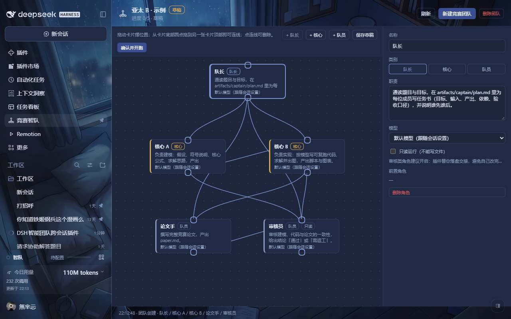

# dsh-competition-team

[English](README.en.md) | 中文

[](https://github.com/zpb332/dsh-competition-team/actions/workflows/test.yml)
[](https://github.com/zpb332/dsh-competition-team/releases/latest)

> 给 DeepSeek Harness 加一支「竞赛智队」：队长负责拆题和派活，核心与队员各自在独立会话里干活，跨会话靠交接文件协作；你在面板上批提案、控预算、看进度。

一个 DSH 插件，不是独立应用。装进 DSH 后，左侧栏会多一个「竞赛智队」入口。





## 它能做什么

- **独立会话的团队**：队长（captain）、核心（core）、队员（member）各自是一个普通 DSH 会话，结果通过 `handoffs/` 交接，不依赖共享上下文。
- **画布工作流**：拖拽角色、连线定依赖、给每个角色选模型；确认后开跑。
- **队长频道**：直接对队长提意见，它分析后用 `dispatch / message / revise` 提案；你在面板批准、驳回或改两笔，执行前还会做冲突检查。
- **任务书**：队长在 `artifacts/captain/plan.md` 里给每个人写任务书，插件解析成一条批量提案；批准后整队任务一次性更新。
- **可信验收**：结构化交接、产物存在性检查、空文件/坏图片/缺章节等确定性质量门；审核员默认只读，不能自己改完自己审。
- **预算**：按成员累计 token，团队默认 3M 上限；80% 告警、100% 暂停派发。
- **自愈**：停滞自动取消重试一次；宿主重载后中断的成员自动续跑一次；确认了但没跑起来的队启动时会接力。
- **审计**：提案、批准、派活、预算、停滞、质量告警都有记录，面板可回溯。
- **通知收件箱**：提案、阻塞、停滞、失败、预算用尽会进持久收件箱；回来打开面板就能看到未读，不会因为关掉页面而错过。

## 环境

- DeepSeek Harness `>= 0.2.1`（`0.2.2-rc.5` 上完成建队、派活、交接真实冒烟；`0.2.2-rc.3` 上跑过完整测试）
- Node.js `>= 20`（仅测试需要）

## 安装

插件没有发布到 npm，从 GitHub 源安装。

### 普通用户

**DSH Desktop**：打开 Settings → Plugins 的安装入口，粘贴：

```text
github:zpb332/dsh-competition-team
```

不同 DSH 版本的入口名称可能略有不同；如果当前版本没有「从源安装」的输入框，用下面的命令。

**dsh web / 自建 profile**：

```bash
dsh plugin --profile web add github:zpb332/dsh-competition-team
```

把 `web` 换成你实际使用的 profile。DSH Desktop 的 profile 由应用管理，不要手改。

装好后在插件设置里重载（或关闭再开启）该插件，左侧栏出现「竞赛智队」即安装成功。

> 已用 `dsh plugin --profile test add github:zpb332/dsh-competition-team` 在干净 profile 里验证：包会装进 `node_modules`，并自动写入 profile 的 `dsh.profile.bundles`；`--dump-config` 能看到 `competition-team` 这一行。如果侧栏没出现，先检查 `bundles` 列表。


> `github:` 默认安装主分支。需要可复现版本时固定到提交：`github:zpb332/dsh-competition-team#<40 位 commit>`；市场条目也会固定提交。

### 本地开发（link）

克隆仓库后，把本地目录 link 进 profile：

1. 克隆仓库到任意目录：
   ```bash
   git clone https://github.com/ZPB332/dsh-competition-team.git
   ```
2. 在 DSH profile 的 `package.json` 里加依赖（Windows 路径注意转义/引号）：
   ```json
   {
     "dependencies": {
       "dsh-competition-team": "link:/absolute/path/to/dsh-competition-team"
     },
     "dsh": {
       "profile": {
         "bundles": ["dsh-competition-team"]
       }
     }
   }
   ```
3. 在 DSH 的插件设置里重载该插件（或在 Web GUI 的插件管理里关闭再开启）。
4. 左侧栏出现「竞赛智队」图标即安装成功。

> 不同 DSH 版本的 profile 字段可能略有差异；以你当前版本的插件安装文档为准。

## 快速上手

1. 点侧栏「竞赛智队」→「新建竞赛团队」，填题目和目标。
2. 在画布上确认默认五人（队长 / 核心 A / 核心 B / 论文手 / 审核员），改职责、连线、选模型。
3. 点「确认并开跑」。队长会先读题、写 `plan.md` 任务书并提交提案。
4. 在队长频道批准任务书，成员按依赖依次开工。
5. 随时给队长留言；它的派活会先变成提案，你批准后才执行。
6. 面板上可以看到每个成员的最近动态、产物、交接、token 消耗和阻塞原因。

## 数据目录

团队数据写在当前工作区：

```
<workspace>/.dsh-competition/<teamId>/
  brief.md
  team.json
  handoffs/<role>.md
  artifacts/<role>/
```

插件索引在 `$DSH_HOME/data/competition-team/index.json`。这些目录默认不应提交到 git。

## 配置（环境变量）

| 变量 | 默认 | 说明 |
| --- | --- | --- |
| `COMPETITION_STALL_MS` | `480000`（8 分钟） | 成员多久没有事件算停滞 |
| `COMPETITION_RETRY_MS` | `5000` | 瞬时错误重试的基值（第二次为 3 倍） |

## 开发与测试

```bash
node --test
```

测试使用模拟宿主和临时目录，不需要启动 DSH；覆盖交接解析、DAG 校验、守卫、只读审核、提案与冲突、预算、停滞/续跑、任务书、质量门、错误重试。

代码结构：

- `index.js`：Host 半，团队状态机、会话调度、HTTP 路由、工具定义。
- `lib/`：纯函数模块（交接解析、DAG 校验、错误分类、质量门），可独立测试。
- `client.js`：Web 半，侧栏入口、面板、画布、提案与预算 UI。
- `test/`、`test-support/`：`node:test` 用例、模拟宿主与 HTTP 请求桩。
- `docs/DETAIL.md`：实现细节与边界。

## 已知限制

- 浏览器通知只在面板打开时生效；关掉 GUI 不会推送（DSH 宿主暂无通用系统通知 API）。错过的提醒会留在持久收件箱里，回来能看到未读。
- 质量门是确定性检查（大小、魔数、章节关键词），不跑代码、不接评审模型。
- 预算只到团队级，没有每成员上限。
- Host 与 Client 仍是两个较大的单文件；HTTP 路由与客户端渲染的测试尚未补齐。
- 依赖 DSH 的内部 Session / SessionController API，DSH 大版本升级可能需要适配。

## 安全

- HTTP 路由只接受同源请求，并校验 `x-competition-team: 1`。
- 产物读取限制在团队目录内，拒绝路径穿越。
- 插件不会主动读取团队目录之外的文件；成员会话的沙箱由 DSH 权限预设控制（审核员默认只读）。

## License

MIT，见 [LICENSE](LICENSE)。